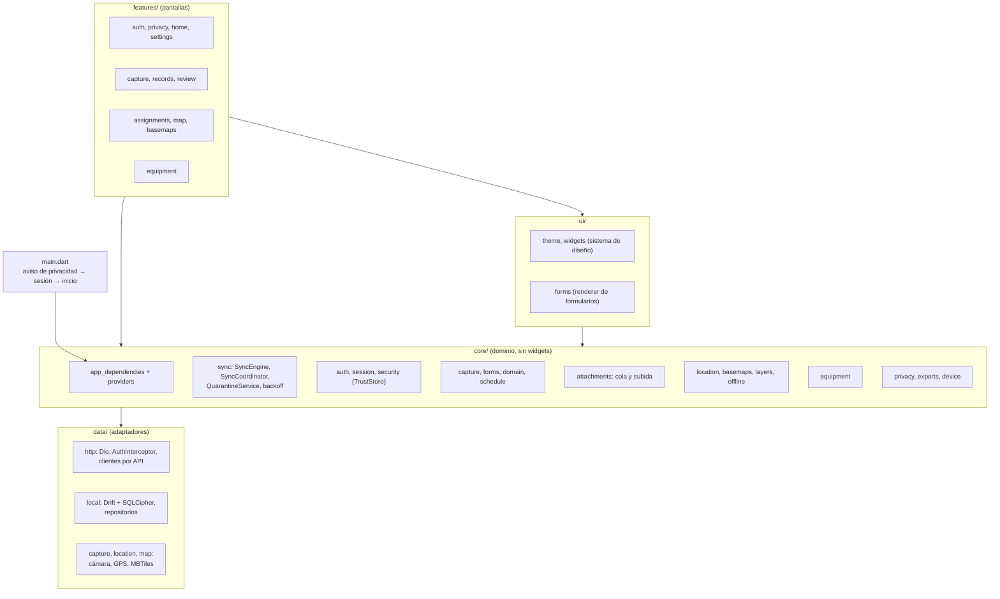

# C4 nivel 3: componentes de la app

La app tiene cuatro capas en `lib/` (ADR-0001 del servidor). Las dependencias van de arriba abajo: `features/` y `ui/` usan `core/`; `core/` define interfaces (`*_transport.dart`, repositorios) que implementa `data/`. `core/app_dependencies.dart` arma el grafo una vez al arrancar ([ADR-0001](../adr/0001-composicion-con-appdependencies.md)).

## `core/`: dominio y sincronización

| Módulo | Responsabilidad |
|---|---|
| `sync/` | `SyncEngine`: drena la outbox (push), aplica el pull por cursor, backoff exponencial con jitter, recupera operaciones `inflight` cortadas. `SyncCoordinator`: dispara el ciclo (inicio, primer plano, cada 5 min, tras guardar), uno a la vez ([ADR-0005](../adr/0005-sincronizacion-con-la-app-abierta.md)). `QuarantineService`: rechazos y conflictos; corregir, reenviar con `op_uuid` nuevo o quedarse con la del servidor ([ADR-0006](../adr/0006-cuarentena-sin-perder-trabajo.md)). `outbox_op_state.dart`: máquina de estados sellada. |
| `auth/`, `session/`, `device/` | Login, refresh único tras un 401, sesión restaurada sin red, logout que siempre cierra en local, traspaso seguro del teléfono a otra persona, id del dispositivo. |
| `security/` | `TrustStore` (pinning SPKI con dos pines y caducidad, TOFU con diálogo), almacén seguro, `PinStore`. Único lugar donde se toca la validación de certificados (lint RD-01). |
| `capture/`, `forms/`, `domain/` | Captura de registros: respuestas, visibilidad (DSL), validación, geometrías, fotos y firma; modelo `Record` con `freezed`. Paridad con el servidor por `contract/fixtures/forms_parity.json`. |
| `schedule/` | Tareas del cronograma (`GET /v1/projects/tasks`), % de avance y filas de cantidades por ítem con hora, GPS y modo de ubicación (piezas 4a/4b del servidor). |
| `attachments/` | Cola de adjuntos: presign, `PUT` directo, commit; reintentos de los fallidos. |
| `location/`, `basemaps/`, `layers/`, `offline/` | GPS con promedio y precisión, sistemas de coordenadas (proj4), navegación a la asignación, descarga reanudable y verificada de mapas base y capas. |
| `equipment/` | Equipos de la organización y outboxes propias de lecturas, preoperacionales, combustible, viajes e informes ([ADR-0007](../adr/0007-equipos-con-outboxes-propias.md)). |
| `privacy/`, `exports/` | Autorización Ley 1581 antes del login; exportación local GeoJSON y PDF. |

## `data/`: adaptadores

| Módulo | Responsabilidad |
|---|---|
| `http/` | `api_client.dart` (Dio con `TrustStore`), `auth_interceptor.dart` y un cliente por superficie: sync, adjuntos, tareas, equipos, mapas base, capas, consentimientos; `resumable_fetch.dart` para descargas con `Range`. |
| `local/` | `tables.dart` y `database.dart` (Drift; `database.steps.dart` con las migraciones), llave de cifrado y repositorios (asignaciones, plantillas, tareas, cola de adjuntos, estado de registros). |
| `capture/`, `location/`, `map/` | Cámara y archivos, fuente de GPS, `mbtiles_tile_provider.dart` para `flutter_map`. |

## `features/` y `ui/`

Pantallas por funcionalidad: `auth` (login y confianza en certificado), `privacy`, `home` (lista y estado de sync), `capture` (registro, geometría, QR, firma, avance y cantidades), `records` (detalle), `review` («Para revisar» y correcciones), `assignments` (lista y navegación), `map`, `basemaps`, `equipment` y `settings`. `ui/` tiene el tema, los tokens y widgets del sistema de diseño y el renderer de formularios dinámicos. Los textos van en `l10n/app_es.arb`.

## Guardias

Lints de `tool/` en CI: sin bypass de TLS (`lint_no_tls_bypass.sh`), sin ejecución dinámica de código (`lint_no_dynamic_code.sh`), sin valores de UI sueltos (`lint_ui_tokens.sh`), nombres (`check_naming.sh`), licencias nuevas (`check_new_licenses.py`), cobertura ≥ 75 % (`check_lcov.py`) y mapa de hallazgos H-01…H-21 (`check_findings_map.py`).
