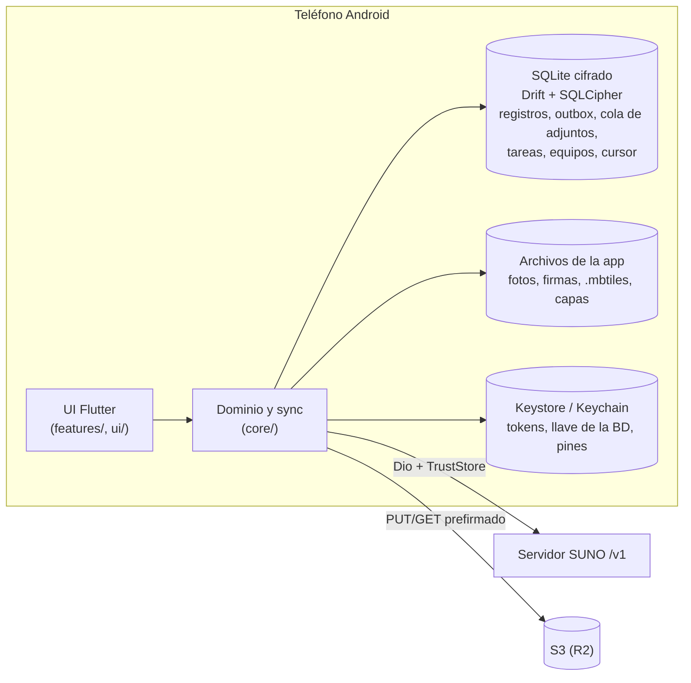

# C4 nivel 2: contenedores

| Contenedor | Tecnología | Responsabilidad |
|---|---|---|
| App | Flutter 3.47.9 / Dart 3.13 | Toda la lógica de campo; funciona sin red. |
| Base local | SQLite vía Drift, cifrada con SQLCipher (WAL, `synchronous=NORMAL`, un escritor) | Registros y su outbox en la misma transacción; cola de adjuntos; cursor del pull; copia de tareas, ítems, asignaciones, plantillas y equipos; outboxes de equipos. Esquema `schemaVersion = 2` (se reinició en 1 con el renombre a SUNO, [ADR-0011](../adr/0011-renombre-reinicia-la-base-local.md)). |
| Archivos | Directorio privado de la app | Fotos y firmas pendientes de subir; mapas base MBTiles y capas GeoJSON descargados y verificados por `sha256`. Sin copia de seguridad en la nube (`allowBackup=false`). |
| Almacén seguro | `flutter_secure_storage` (Keystore, Keychain *ThisDeviceOnly*) | Refresh token, llave de SQLCipher, pines TOFU, id del dispositivo. |
| Servidor | Django + Ninja (SUNO_server) | Ver la arquitectura del servidor. |
