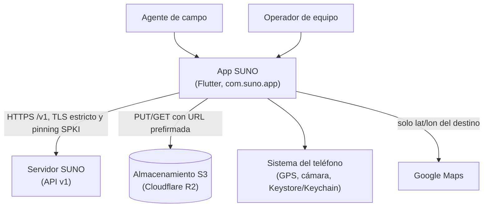

# C4 nivel 1: contexto de la app

| Actor o sistema | Relación |
|---|---|
| Agente de campo | Captura registros sin conexión: formulario dinámico, GPS, fotos, firma, QR, líneas y polígonos, avance de tareas o cantidades por ítem. Ve asignaciones, mapa, mapas base y capas; resuelve lo que el servidor rechazó («Para revisar»). |
| Operador de equipo | Lecturas de horómetro, preoperacionales, combustible, viajes e informes de uso. |
| Servidor SUNO | Autoridad de los datos: sync, adjuntos, tareas, equipos, mapas base, capas y consentimientos ([`flujos.md` del servidor](https://github.com/PMAPP-Org/SUNO_server/blob/master/docs/arquitectura/flujos.md)). |
| Almacenamiento S3 | Las fotos y firmas suben directo, sin pasar por el API; los mapas base y capas se descargan igual. |
| Sistema del teléfono | GPS (`geolocator`), cámara (`image_picker`, `mobile_scanner`), almacén seguro (`flutter_secure_storage`). |
| Google Maps | Abre la ruta a una asignación; ver [`../c4-navegacion.md`](../c4-navegacion.md). |

La URL del servidor y los pines SPKI se fijan al compilar ([ADR-0009](../adr/0009-servidor-fijado-en-compilacion.md)).
